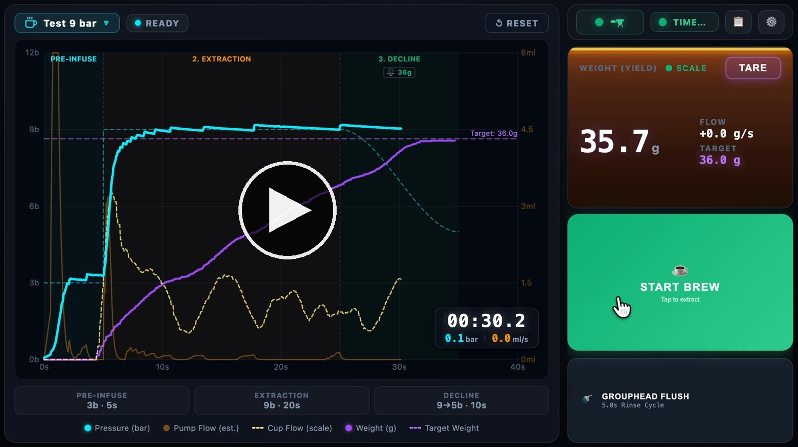
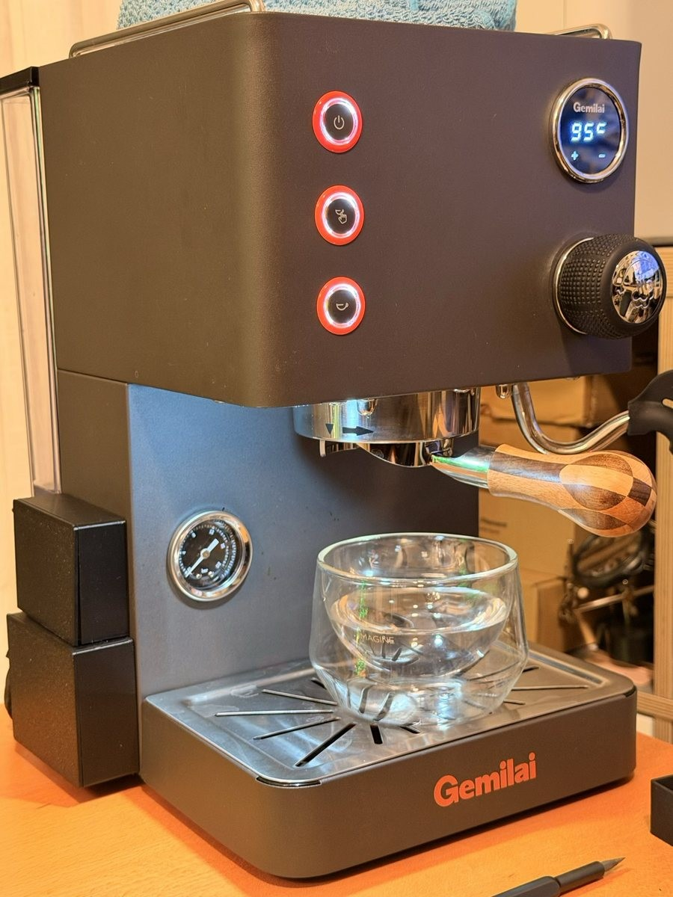
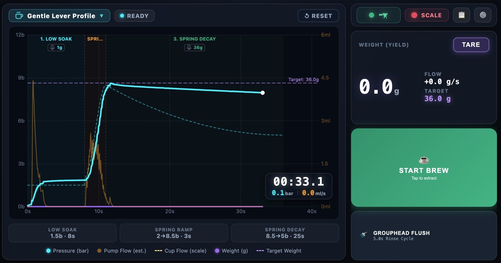
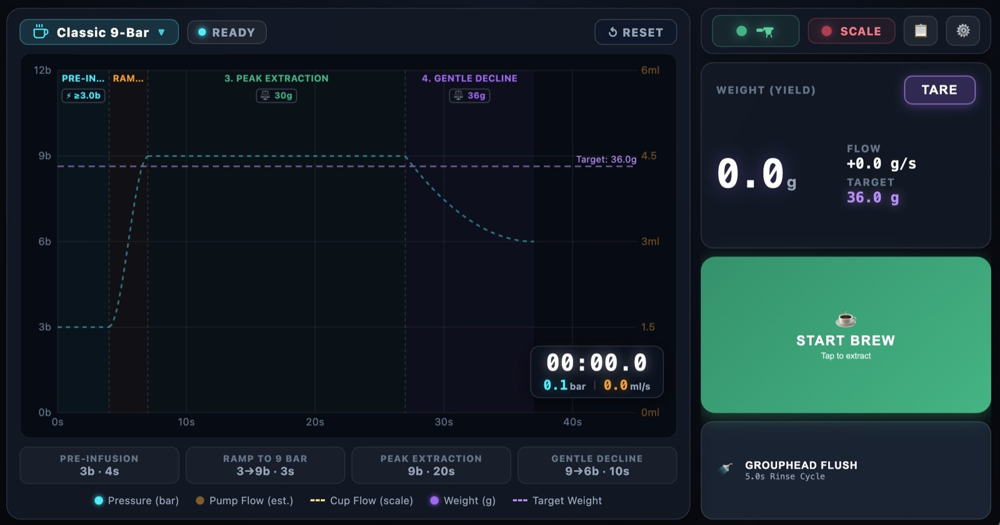
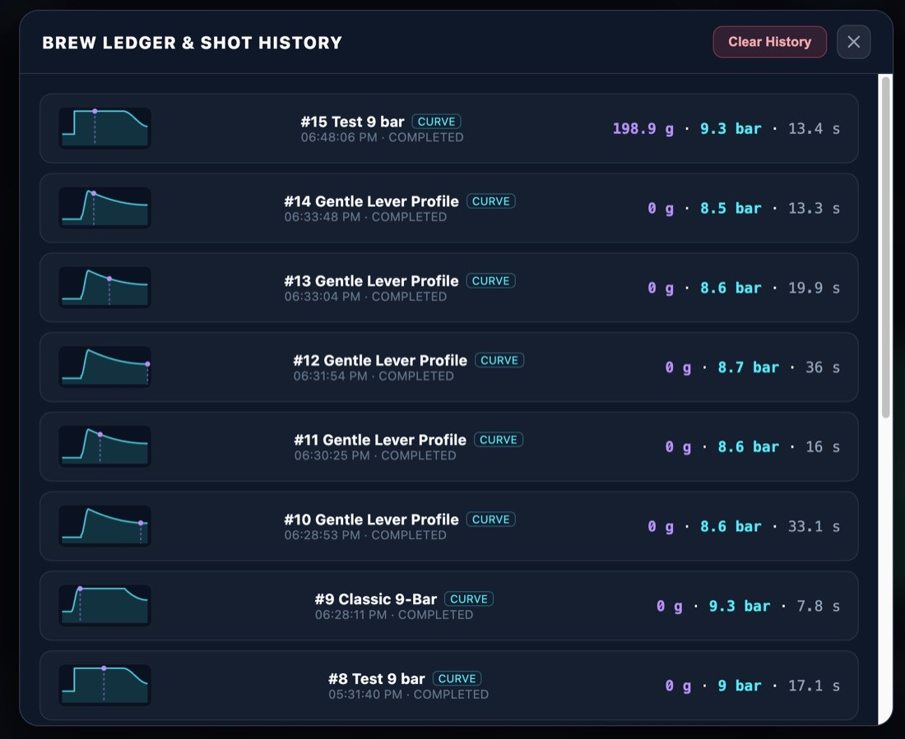
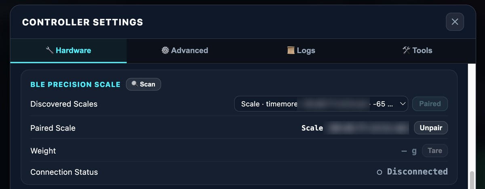
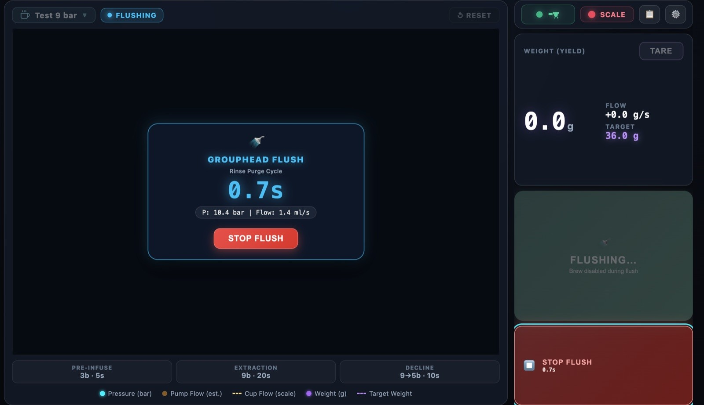
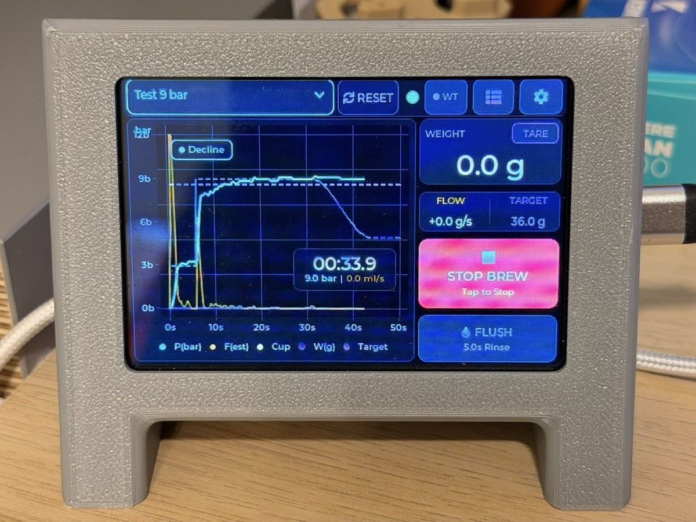
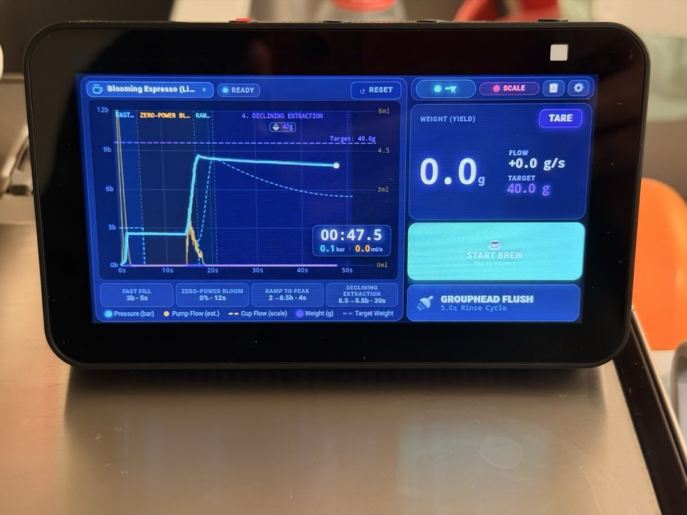
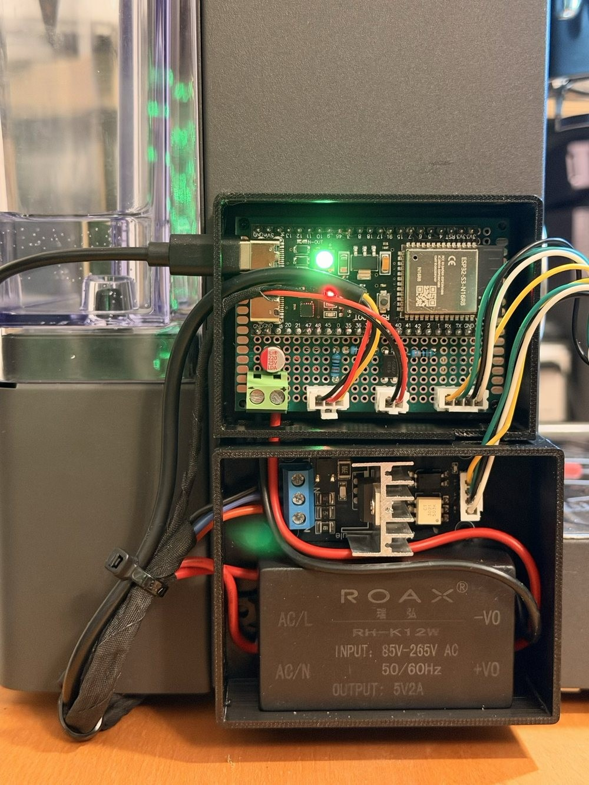

# Smart Brew Controller

A pressure and flow profiling controller for espresso machines that already have their own logic
board and a momentary brew button (for example Gemilai 3007L, Lelit Elizabeth/Mara/Victoria,
Breville/Sage and Gaggia digital models).

It replaces nothing. The machine keeps its boiler control, 3-way solenoid, autofill and safety
cut-outs. The controller adds a TRIAC stage in the pump feed, a pressure transducer on the brew
line and an isolated relay across the brew button. That lets it press the button, then run the pump
along a multi-phase pressure or flow profile and stop the shot on weight from a Bluetooth scale.

[](docs/video/brew-video.mp4)
<sub>**A real shot, start to finish** (51 s video, click to play). Pre-infusion at 3 bar, extraction at
9 bar, then the Bluetooth scale stops the shot at the 36 g target. Cyan is the measured pressure,
purple the weight in the cup, the dashed yellow line the flow the scale measures.</sub>

> **⚠ Mains voltage.** This project switches the pump's 110/230 V AC supply and is wired into a
> machine that holds a pressurised boiler. Wrong wiring can cause electric shock, fire, or a
> scalding release of hot water or steam. Only build it if you are competent to work on mains
> equipment, keep the machine unplugged while you work on it, and read
> [`docs/Hardware.md`](docs/Hardware.md) first. Modifying your machine will probably void its
> warranty. The project is provided as is, without warranty (see [`LICENSE`](LICENSE)), and you
> use it at your own risk.

## Background



My first espresso machine was a Gemilai 3007L. I soon found that it had no over-pressure valve
(OPV), so I fitted an aftermarket one. At the same time I wired the pump through a simple dimmer,
which let me set the brew pressure by hand. That worked well, but it meant turning a knob during
every shot.

I also realised that if a Bluetooth scale could stop the shot at the right weight, I would not
have to watch the machine while it brewed. The machine has a single boiler, so it cannot steam
while it brews, but I could get the milk ready in the meantime.

I had built several ESP32 projects before, so I started this one with a simple goal: replace the
manual dimmer with an ESP32 and let it press the brew button too. The ESP32 also has Bluetooth, so
it can read the scale. Put together, the controller can run the pump at a different pressure in
each stage of the shot and stop it on weight.

Some commercial machines already do all of this, and they inspired the modification. While working
on it, I realised that other DIYers and coffee lovers could use the same thing on their own
machines. So the project is open: build your own, adapt it to your machine, and if you can, help
make it better (see [Contributing](#contributing)).

<br clear="right">

---

## What it does

- **Profiles.** Multi-phase pressure, flow, power and pause phases, with shaped ramps and exit
  triggers on time, pressure, flow and weight. A visual editor is in the dashboard. Profiles can
  be imported from and exported to common JSON profile formats.
- **Closed-loop control at 100 Hz.** PID with feed-forward from a pump model, derivative on
  measurement and anti-windup during pre-infusion.
- **Weight-based stop.** Predictive cutoff from the cup's flow rate, with a drip lag the
  controller learns from each shot. The yield recorded is the weight that actually ended up in the
  cup.
- **Self-calibrating flow model.** The pump flow estimate is calibrated against the scale over the
  steady part of each shot ([`docs/PumpFlow.md`](docs/PumpFlow.md)).
- **Safety.** Pre-brew hardware check and verified tare; over-pressure, sensor-fault, lost
  zero-cross and maximum-time cut-offs; the power stage is disarmed during firmware updates.
- **Clients.** A web dashboard served by the controller (also installable as a PWA), an Android
  app for the Amazon Echo Show 5, and a Waveshare 3.5" touch display. All of them show the live
  pressure, the modelled and measured flow, and the weight. The last 15 shots, with their
  curves, are kept in a brew ledger on the controller.
- **Works without a client.** Profiles, interlocks and the weight stop all run on the controller,
  so a display or phone that disconnects mid-shot changes nothing.

## Screenshots

### Web dashboard


<sub>**Shot graph.** Measured pressure (solid cyan) over the profile's target (dashed), with the
estimated pump flow in amber. This Gentle Lever test ran on a blind basket: with no water flowing
through it, the pressure holds instead of following the decline.</sub>

| | |
|---|---|
|  |  |
| **Brew screen.** The selected profile's target curve and phases, the scale's weight and flow, and one-tap Start Brew and Grouphead Flush. | **Brew ledger.** The last 15 shots, each with its pressure curve, yield, peak pressure and shot time. |
|  |  |
| **Scale pairing.** Scan for Bluetooth scales, pair one, tare it and see its connection state. | **Grouphead flush.** A timed rinse of the group, with live pressure and flow and a stop button. |

### Dedicated displays

| | |
|---|---|
|  |  |
| **Waveshare ESP32-S3-Touch-LCD-3.5B** in a 3D-printed stand, mid-shot ([`display-waveshare-3.5/`](display-waveshare-3.5/README.md)). | **Amazon Echo Show 5** running the Android app on LineageOS ([`android-app/`](android-app/README.md)). |

## Hardware at a glance



The prototype on the Gemilai 3007L. The top box holds the ESP32-S3 on perfboard, with plug-in
connectors for the sensor and control wiring. The bottom box
holds the RobotDyn AC dimmer and a 5 V mains power supply. The cases are in
[`3D print/`](3D%20print/).

<br clear="right">

| Part | Supported |
|---|---|
| Controller | ESP32-S3-WROOM-1 N8R8 (8 MB flash, 8 MB PSRAM), e.g. ESP32-S3-DevKitC-1 |
| Power stage | RobotDyn AC dimmer module (zero-cross output + TRIAC gate) |
| Pressure | 0.5–4.5 V transducer (1.2 or 1.6 MPa) through a 10 k/20 k divider, ADS1115 or the internal ADC |
| Brew button | TLP222A / AQY212EH PhotoMOS relay (or PC817) across the machine's button |
| Pumps | Ulka EX5/EP5, Ulka EX4/EP4, Olab Silent Green, or custom parameters |
| Scales (BLE) | Bookoo Themis, Timemore Black Mirror, Acaia Lunar/Pearl/Pyxis, Felicita, Decent, Cocinare, and the companion ESP32-C3 scale in this repo |
| Displays | Web browser / PWA, Android (Echo Show 5), Waveshare ESP32-S3-Touch-LCD-3.5B |

Parts list, wiring, GPIO map and first power-up checks: [`docs/Hardware.md`](docs/Hardware.md).

## Roadmap

- **A compact circuit board.** The prototype lives in two boxes on the outside of the machine. A
  dedicated board that combines the controller, the power stage and the power supply, and is small
  enough to fit inside the machine, is being designed.

## Quick start

You need [PlatformIO](https://platformio.org/) (CLI or the VS Code extension).

```bash
./flash.sh          # build the controller firmware and flash it over USB (asks for the port)
./monitor.sh        # serial console at 115200 baud - type `help`
```

1. **First boot.** With no Wi-Fi stored, the controller opens a hotspot named `SmartBrew-XXXX`.
   Join it from a phone; the setup page opens by itself (or go to `http://192.168.4.1/wifi`).
   Enter your 2.4 GHz network.
2. **Open the dashboard** at `http://smartbrew.local`, or at the IP address the console prints.
3. **Before the first shot**, set the pump model, sensor range, mains frequency and ADC source in
   Settings → Hardware, and run through the bench checks in [`docs/Testing.md`](docs/Testing.md).

> A normal firmware flash keeps the brew ledger, the profiles and the settings. `pio run -t uploadfs`
> and a full chip erase do not. See [`docs/Operation.md`](docs/Operation.md) before using them.

Building the display, the companion scale, the simulator and the Android app, plus OTA updates,
console commands, logs and troubleshooting, are all in [`docs/Operation.md`](docs/Operation.md).

## Documentation

| Document | Read it to… |
|---|---|
| [`docs/Hardware.md`](docs/Hardware.md) | choose parts, wire and solder the controller, and power it up safely |
| [`docs/Operation.md`](docs/Operation.md) | build and flash every program, set up Wi-Fi, update over the air, use the console, read the logs |
| [`docs/Dashboard.md`](docs/Dashboard.md) | use the web dashboard, the Android app and the Waveshare display |
| [`docs/Profiles.md`](docs/Profiles.md) | write, import and export brew profiles; the profile JSON format |
| [`docs/Testing.md`](docs/Testing.md) | run the automated tests and verify a build on the bench, stage by stage |
| [`docs/Architecture.md`](docs/Architecture.md) | understand how the firmware works: tasks, state machine, power stage, control loop, safety |
| [`docs/PumpFlow.md`](docs/PumpFlow.md) | understand the flow model, cup flow, weight cutoff and self-calibration |
| [`docs/API.md`](docs/API.md) | integrate with the controller: REST, WebSocket telemetry frame, commands, config keys |

Sub-projects have their own READMEs:
[`display-waveshare-3.5/`](display-waveshare-3.5/README.md),
[`companion-c3-scale/`](companion-c3-scale/README.md),
[`simulator-esp32s3/`](simulator-esp32s3/README.md),
[`android-app/`](android-app/README.md).

## Repository layout

```
include/                 shared headers: pins, config, profiles, pump model, telemetry frame
src/                     controller firmware
  brew_controller.*      brew state machine, interlocks, pre-brew gate, telemetry
  hal/                   power stage (zero-cross, TRIAC), pressure sensor, button relay
  control/               PID, profile engine, shot ledger, flow and weight rules
  scale/                 BLE scale manager and drivers
  network/               Wi-Fi, web server and API, UART bridge, OTA
data/index.html          web dashboard (compiled into the firmware at build time)
display-waveshare-3.5/   Waveshare 3.5" touch display firmware (LVGL)
companion-c3-scale/      ESP32-C3 + HX711 Bluetooth scale
simulator-esp32s3/       hardware-in-the-loop simulator and host regression tests
android-app/             Android companion app (wraps the web dashboard)
tools/                   serial monitor, web asset generator, flash and telemetry tools
docs/                    documentation (see above)
LICENSES/                full texts of third-party licenses
```

## Contributing

Contributions are welcome. [`CONTRIBUTING.md`](CONTRIBUTING.md) covers building, testing, and the
rules that keep the controller and its clients compatible. Report anything that could make the
hardware unsafe privately, as described in [`SECURITY.md`](SECURITY.md).

## License

This project is licensed under the **Creative Commons Attribution-NonCommercial-ShareAlike 4.0
International License (CC BY-NC-SA 4.0)**. See [`LICENSE`](LICENSE) for the full text.

- **Personal use:** you may view, build, modify and use this controller for your own
  non-commercial purposes.
- **Non-commercial:** manufacturing or selling boards, kits or assembled devices, or other
  commercial use, requires prior written permission from the copyright holder.
- **ShareAlike:** if you distribute a modified version, distribute it under the same license.
- **Commercial enquiries:** contact the repository owner.

Third-party components keep their own licenses. They are listed in
[`THIRD_PARTY.md`](THIRD_PARTY.md), and their full texts are in their folders or in
[`LICENSES/`](LICENSES/).

### Trademarks

Product and company names in this repository (scale, pump, display, board and espresso-machine
brands) are trademarks of their respective owners. They are used only to state compatibility. This
project is independent and is not affiliated with, endorsed by or sponsored by any of them.
